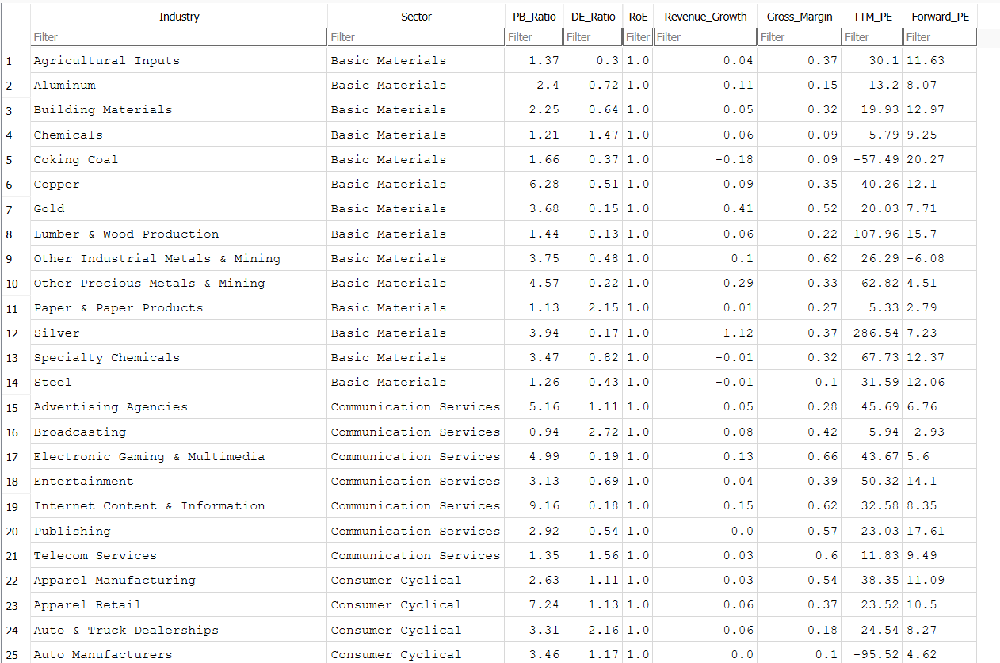
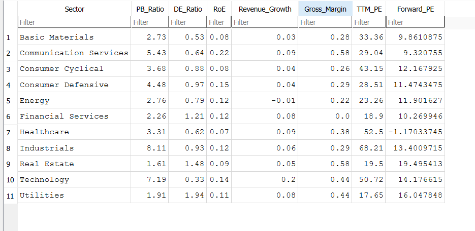

# 📈 Peer Benchmarks 

A python based research tool that calculates various sector and industry benchmarks using data obtained
from the yfinance API. Benchmarks are stored in a SQLite file. 

---

### ➕ Calculation Methodology ➗
For the following metrics:
- Price to Book Ratio
- Debt to Equity Ratio
- Return on equity
- Revenue Growth 
- Gross Margin
- TTM P/E

the weighted average was calculated by obtaining data from each company in the sector/industry and
summing the totals and then dividing. For example, price to book was calculated by calculating the total sum
of each company's market cap and equity in a peer group and then dividing total market cap by
total equity. This methodology was used for each ratio and its respective inputs.

Forward P/E for each peer group was found by obtaining the median of each respective peer group.

---

## 📂 File Structure
```
peer-benchmarks
├── peer_benchmarks/
│   ├── src/ # Source scripts for screening and analysis
│   │    ├── industry/ # Scripts for calculaing industry benchmarks
│   │    │    ├── indsutry_calculator/
│   │    │    │    ├── __init__.py
│   │    │    │    └── calculator.py
│   │    │    ├── __init__.py
│   │    │    └── industry_avg.py # Commit data to SQLite database
│   │    ├── screeners/
│   │    │    ├── __init__.py
│   │    │    └── screeners.py # Use the yfinance API to pull stocks in each peer group 
│   │    ├── sector/ # Scripts for calculaing sector benchmarks
│   │    │    ├── sector_calculator/
│   │    │    │    ├── __init__.py
│   │    │    │    └── calculator.py
│   │    │    ├── __init__.py
│   │    │    └── sector_avg.py # Commit data to SQLite database
│   │    ├── web_scraping/
│   │    │    ├── __init__.py
│   │    │    └── web_scraper.py # Pulls the available industry and sector benchmark titles    
│   │    └── __init__.py    
│   ├── __init__.py
│   ├── config.py # Paths for saving benchmark data
│   └── main.py # Main script for calculating benchmarks
├── ex_images/ # Stores example iamges for README
├── README.md # Current file
└── environment.yml # Required packages
```

---

## 🚧 Setup Instructions

1. **Clone the repo and enter it**
```bash
   git clone https://github.com/JustinWoo20/peer-benchmarks.git
   cd peer-benchmarks
```

2. **Create the environment and install dependencies** (choose one)

   **Option A: Conda**
```bash
   conda env create -f environment.yml
   conda activate peer-benchmarks
```

   **Option B: venv + pip**
```bash
   python -m venv .venv
   source .venv/bin/activate      # macOS/Linux
   .\.venv\Scripts\activate       # Windows
   pip install -r requirements.txt
```

3. **Get an API key**

   Create a free key at [ExchangeRate-API](https://www.exchangerate-api.com/docs/python-currency-api), then create a `.env` file in the project root:
```
   EXCHANGE_RATE_API_KEY=your_key_here
```

4. **Run the calculator**
```bash
   python -m peer_benchmarks.main
```
   Choose sector, industry, or both when prompted.

---

## 📷 Example Outputs




---
## 📌 Future Improvements
- Add additional financial ratios
- Add regional peer groups

---

### 📜 License
MIT License – free to use, modify, and distribute.

---
### ⚠️ Disclaimer
This tool is not licensed financial advice. It is intended for assistance in personal research.
Always perform independent research and consult a licensed financial professional before 
making any financial decisions.